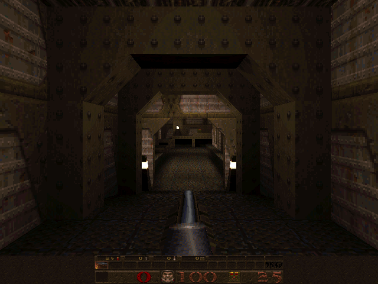

# raylib Quake

id Software's GPL Quake (WinQuake software renderer) ported to [raylib](https://www.raylib.com/).
Above: shareware E1M1 rendered by this port on Linux x86_64.

- Original id Software readme: [readme.txt](readme.txt)
- Port notes and build instructions: [docs/PORTING.md](docs/PORTING.md)
- Testing harness: [docs/TESTING.md](docs/TESTING.md)

## Build

Needs a C compiler (GCC or Clang), CMake 3.16+ and Ninja (or Make). raylib 6.0 is used if installed, otherwise it is downloaded and built statically (FetchContent).

```sh
cmake -S . -B build -G Ninja -DCMAKE_BUILD_TYPE=RelWithDebInfo
cmake --build build -j4
```

This produces `build/quake` (raylib drivers) and `build/quake-null` (null drivers: headless / dedicated, no raylib). `-DQUAKE_RAYLIB=OFF` builds only the null `quake`.

### Linux

raylib's GLFW needs the X11 and OpenGL development packages (e.g. on Debian/Ubuntu `libx11-dev libxrandr-dev libxinerama-dev libxcursor-dev libxi-dev libgl1-mesa-dev`).

### macOS (Apple Silicon or Intel)

```sh
xcode-select --install          # Apple Clang
brew install cmake ninja        # raylib is optional: it is fetched if missing
brew install sevenzip           # only for tools/fetch_shareware.sh (provides 7zz)
cmake -S . -B build -G Ninja
cmake --build build -j"$(sysctl -n hw.ncpu)"
```

Tested on macOS 26 / arm64, Apple Clang, CMake 3.29, Ninja 1.12: no compiler warnings from the engine. The only diagnostic is a warning from raylib's vendored `stb_vorbis.c`. raylib's OpenGL deprecation notice during configure is harmless; Cocoa, IOKit and OpenGL come from the macOS SDK. Use `-DCMAKE_DISABLE_FIND_PACKAGE_raylib=ON` to force the FetchContent copy over a Homebrew raylib.

## Game data

Only the shareware data may be used for testing; it is never committed (`data/` is ignored).

```sh
./tools/fetch_shareware.sh      # checksum-pinned download of id1/pak0.pak into data/
./build/quake -basedir "$PWD/data" -width 640 -height 480
```

Smoke test without a window: `./build/quake-null -basedir "$PWD/data" -condebug +timedemo demo1`, then read `data/id1/qconsole.log` (expect `969 frames`; demo2 985, demo3 1090). The engine keeps looping the attract demos afterwards, so stop it yourself. `tools/verify.sh` is Linux-only (needs Xvfb).
