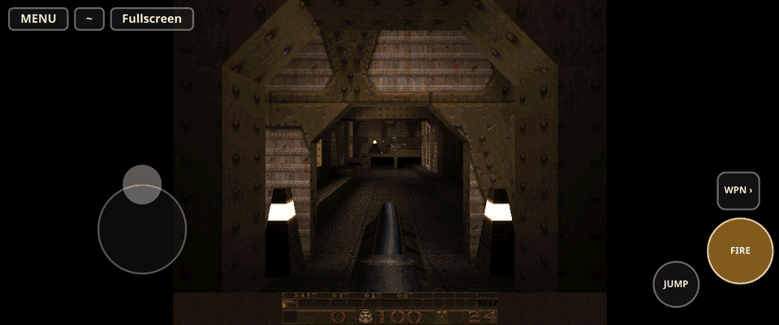
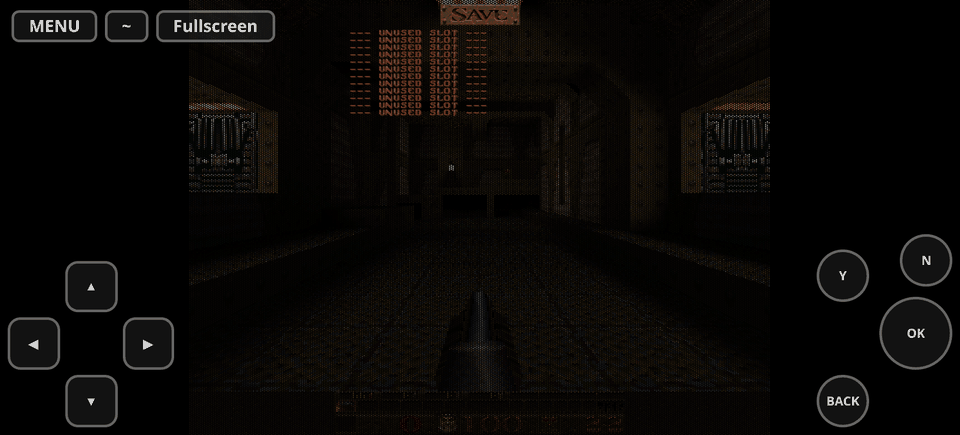

# Browser (WebAssembly) build

The software-rendered `quake` target also builds with Emscripten and raylib's
web platform (`PLATFORM_WEB`, WebGL 1 / OpenGL ES 2). It plays the
shareware episode in a page; it is live at https://www.raydelto.org/quake.

## Build

Needs an activated [emsdk](https://emscripten.org/docs/getting_started/downloads.html)
(built and tested with Emscripten 6.0.10), CMake ≥ 3.16 and Ninja or Make.
raylib 6.0 is downloaded by CMake, as for the desktop build.

```sh
./tools/fetch_shareware.sh            # data/id1/pak0.pak + data/shareware/{SLICNSE,LICINFO}.TXT
source ~/emsdk/emsdk_env.sh
emcmake cmake -S . -B build-web -G Ninja
cmake --build build-web
python3 -m http.server -d build-web 8000   # then open http://localhost:8000/
```

Configuring fails if `pak0.pak` is not the checksum-pinned shareware 1.06
file (`-DQUAKE_WEB_PAK=...` points elsewhere) or the license texts are
missing. The PAK is only ever in the build directory, never in git.

`build-web/` then holds everything a web server needs:

| File | What |
|---|---|
| `index.html` (= `quake.html`) | The page, from `web/shell.html`: canvas, loading bar, controls, credits and license links |
| `quake.js`, `quake.wasm` | The engine (≈ 0.2 MB + 0.7 MB) |
| `quake.data` | The unmodified shareware `pak0.pak`, preloaded into `/quake/id1/pak0.pak` (18.7 MB) |
| `SLICNSE.TXT`, `LICINFO.TXT` | id's shareware license and distribution terms, which must accompany the PAK |
| `gnu.txt` | The GPL v2 |
| `.htaccess` | `application/wasm` for `.wasm`, `DirectoryIndex index.html` (Apache / LiteSpeed) |

Serve it over HTTP(S); `file://` URLs cannot load the `.data`/`.wasm`.

## How it differs from the desktop build

- **Frame loop:** `main` runs `Host_Init` and then hands
  `Sys_WebFrame` to `emscripten_set_main_loop`, which the browser calls
  once per display frame (`requestAnimationFrame`). `Host_Frame` already
  returns at once between its 72 Hz frames, so nothing else had to change.
  This was chosen over ASYNCIFY, which would keep the native `while (1)`
  loop but instruments the whole engine (larger, slower wasm) for one
  blocking call. The only blocking wait left, `SCR_ModalMessage` (the
  "start a new game?" question while a game is running), answers yes in
  the browser; raylib's web `WindowShouldClose` (it sleeps) is not called.
- **Data and saves:** `-basedir /quake`. The page mounts IndexedDB (IDBFS)
  at `/persist`, copies its files into `/quake/id1` before the game starts,
  and copies `config.cfg` and `*.sav` back whenever they change (checked
  once a second from the frame loop, on quit, and when the tab is hidden).
  The PAK is never stored in IndexedDB.
- **Quit and errors:** `Sys_Quit` and `Sys_Error` stop the main loop and
  call the page (`Module.quakeQuit` / `Module.quakeError`), which shows a
  message and a "Play again" (reload) button.
- **Audio:** the same `snd_raylib.c` DMA driver on raylib's miniaudio Web
  Audio backend. The game starts from the "Click to play" button, so the
  audio context is created inside a user gesture and is allowed to run.
- **Mouse:** browsers allow pointer lock only from a user's event, so the
  bridge tells the page when the game wants the mouse
  (`Module.quakeWantsPointer`: playing, not in a menu, the console or a
  demo) and the page locks it on the next click on the canvas. Motion comes
  from the browser's `movementX/Y`. `Esc` (the browser's) lets it go.
  The browser can still refuse the lock; the page then logs
  `Pointer lock refused: <reason>` (a console warning) and says so in the
  hint over the game, instead of leaving an unhandled promise rejection.
- **Touch:** see [Touch controls](#touch-controls) below.
- **Video:** the frame is 640×480 (`-width`/`-height` still work), drawn 2×
  into a 1280×960 canvas, which the page scales to fit, 4:3. Fullscreen is
  the page's: the Fullscreen button or `Alt+Enter`.
- **Network:** no sockets in a page; the build links id's `net_none.c`
  (loopback only), so single player and demos work and multiplayer does not.

Extra command-line options go in the URL: `?args=-skill%202%20%2Bmap%20e1m2`.

## Touch controls

On a phone or tablet (the page's main pointer is coarse:
`matchMedia('(pointer: coarse)')`), the game fills the screen once it
starts and `web/shell.html` lays touch controls over it, clear of the notch
and the home bar (`viewport-fit=cover`, `env(safe-area-inset-*)`).
`?touch=1` forces them on (a desktop keeps its mouse and pointer lock too),
`?touch=0` off. Keyboard and mouse work either way.

| Layout | When | Controls |
|---|---|---|
| play | playing (`key_game`, connected, no demo) | left half: a stick where the thumb lands (forward/back and strafe; walk near the centre, run at the rim); right half: drag to look (yaw and pitch, always free look, `touch_look` degrees per CSS pixel, default 0.3); FIRE, JUMP, WPN › (next weapon); MENU (Esc) |
| menu | menus, the demo loop, the title | ▲▼◀▶, OK (Enter), BACK (Esc), Y, N; a tap on the picture is Enter, a swipe moves the cursor one step per 40 px |
| console | console or chat line | ⌨ opens the phone's keyboard, OK, BACK, ~ closes the console |




`?console=1` adds a ~ button (console toggle); it is hidden by default.
In portrait the page asks the player to turn the device; the Fullscreen
button makes the whole page fullscreen and locks landscape where the
browser allows it (not iPhone Safari, which has no fullscreen for pages).

How it reaches the game: the page tracks every finger (capture-phase
listeners on `document`, so raylib's own touch handling never sees them)
and calls one exported entry in the raylib bridge,
`RL_WebTouch(bits, movex, movey, lookx, looky)` (`WinQuake/bridge_raylib.c`,
bits `RLT_*` in `bridge_raylib.h`), plus `RL_WebTouchKey(code)` for the
phone keyboard and `RL_WebTouchEnable(1)` before the game starts.

- Menu buttons become key events (Esc, Enter, arrows, `y`, `n`, `` ` ``)
  in the bridge's queue, so `Key_Event` handles them like keys.
- FIRE and JUMP run `+attack`/`-attack` and `+jump`/`-jump`, WPN ›
  `impulse 10` (`in_raylib.c`): what the default keys are bound to, but
  independent of the player's bindings. A tap shorter than a frame is held
  for one frame.
- The stick and the look drag go into the `usercmd_t` and `cl.viewangles`
  in `IN_Move`, as mouse look does; pitch drift is stopped while touch
  controls are on, so the view stays where the player looked.
- `in_raylib.c` tells the page which layout to show
  (`Module.quakeTouchMode`, `Module.quakeOnTouchMode`: 0 menu, 1 play,
  2 console) from `key_dest` and the client state each frame.
- A phone never asks for pointer lock and shows no mouse hint. The first
  tap ("Tap to play") starts the game, so the Web Audio context is created
  inside a user gesture.

raylib.h stays in `bridge_raylib.c`; the native build compiles the touch
functions as stubs and registers no new cvar.

## Testing

`tools/web_touch.mjs` (QUAK-29) plays the build by touch in Playwright's
Pixel 7 and iPhone 14 landscape emulation, with real multi-finger touch
events (CDP `Input.dispatchTouchEvent`): tap to play (audio context
running), demo → main menu → Single Player → New Game, the console button
and the phone keyboard for `map e1m1`, move with the stick while FIRE is
held (the ammo count drops), look left/right and down, JUMP, WPN ›, MENU
and BACK, save in slot 0 (and in IndexedDB) and load it, the quit question
answered N, portrait (rotate hint), no scrolling. Then a desktop checks
there is no overlay, keys move and fire, pointer lock on a click and mouse
turning, and that `?touch=1` forces the overlay. It fails on any page or
console error.

```sh
PLAYWRIGHT=~/.npm/_npx/e41f203b7505f1fb/node_modules/playwright/index.mjs \
  node tools/web_touch.mjs build-web web-touch     # 43 checks; shots in web-touch/
```

It needs Playwright 1.62 with its Chromium. Emulation is not a phone:
iOS Safari and Android Chrome themselves, real multi-touch hardware and
on-screen keyboards are not covered.

What was checked for QUAK-25 (headless Chromium and Firefox through
Playwright, SwiftShader WebGL): the page loads with no console errors, the
demo loop runs after the click, the Web Audio context is `running`, Esc →
Single Player → New Game starts `start.bsp`, moving and firing work, the
game wants the pointer in play, `save` writes a `.sav` that reaches
IndexedDB, `quit` shows the end screen, and after a reload `config.cfg`
and the save are restored and `load` works. Not tested: real speakers,
real pointer lock with a physical mouse, Safari, real phones (touch is
tested in emulation, above).

Headed Chromium under a bare Xvfb (no window manager) sometimes refuses
every pointer lock for the whole session with `WrongDocumentError` ("The
root document of this element is not valid for pointer lock."): the
browser process does not consider its window focused, although
`document.hasFocus()` is true under Playwright's focus emulation and
keys still arrive. QUAK-26 hit it in 15 of 18 runs of six or nine
concurrent sessions during one window, then in none of 36 more; it never
happened on a single session. Treat it as the test display, not the game,
and rerun that browser alone.

## Data license

The engine is GPL. The game data is not: only the unmodified shareware
`pak0.pak` is bundled, free of charge, together with `SLICNSE.TXT` (§6 lets
it be redistributed electronically, as a whole, free, with the agreement
accompanying it). Registered Quake data must never go into a page.
